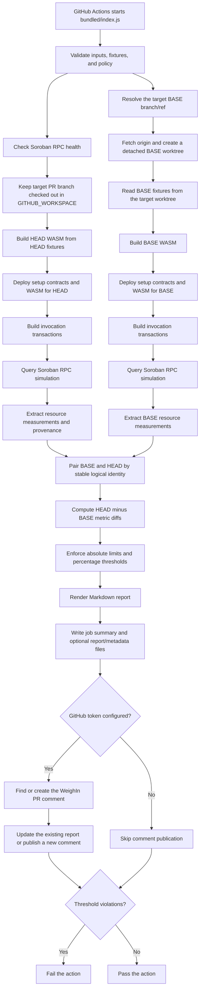

# WeighIn Architecture

WeighIn is a GitHub Action and CLI for measuring Soroban contract resource
usage, comparing revisions, enforcing configured policies, and publishing a
pull request report.

## Execution pipeline

The target branch is the PR base branch, unless `base-ref` is supplied.
WeighIn fetches that ref and creates a separate detached worktree; it does not
merge the base into the PR branch or modify the HEAD checkout. HEAD and BASE
measurements use their own fixture declarations and build artifacts. Both sets
of invocation transactions are sent to RPC simulation, not submitted as normal
benchmark writes.

The diff uses fixture, logical contract, function, and case identities. Runtime
contract addresses and WASM hashes are recorded for provenance, but they are
not the comparison key.

## Core module responsibilities

| Module | Responsibility |
| --- | --- |
| `src/cli.ts` | Parses CLI arguments and provides the standalone measurement entry point. It can measure existing fixtures, optionally compare BASE and HEAD fixture results, and emit JSON or thresholds. |
| `src/measurement.ts` | Parses and validates fixtures, prepares and deploys setup contracts, builds invocation transactions, calls the Soroban RPC/native simulation path, and converts simulation output into benchmark records and metrics. |
| `src/diff.ts` | Matches BASE and HEAD benchmark records by logical identity and calculates per-metric absolute deltas, percentages, availability, and aggregate differences. |
| `src/threshold.ts` | Loads and validates `weighin.toml`, resolves effective policy rules, and evaluates measurement diffs against global, function, or aggregate limits and thresholds. |
| `src/comment.ts` | Finds the existing WeighIn report comment, renders the Markdown report, resolves the report-author identity, and creates or updates the PR comment. |

The GitHub Actions orchestration in `src/action.ts` wires these modules together:
it validates configuration, checks out the target branch, builds and measures
both revisions, creates the diff, applies thresholds, writes outputs, and
publishes the comment.
